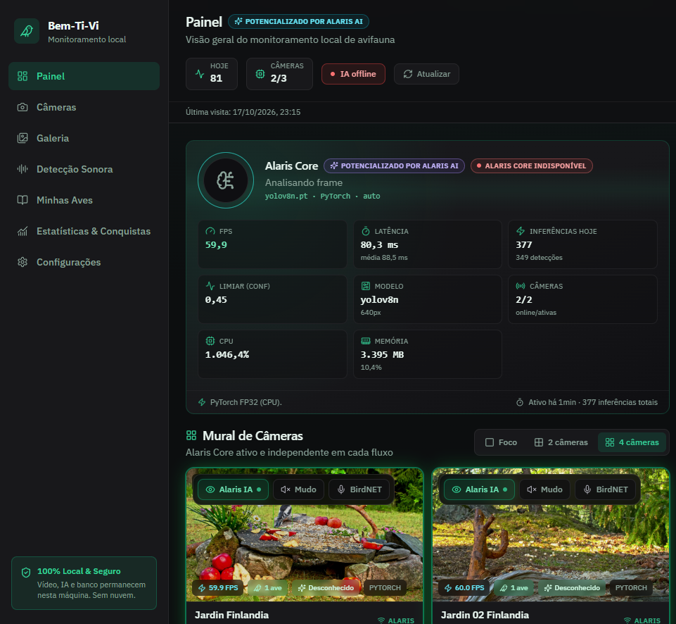
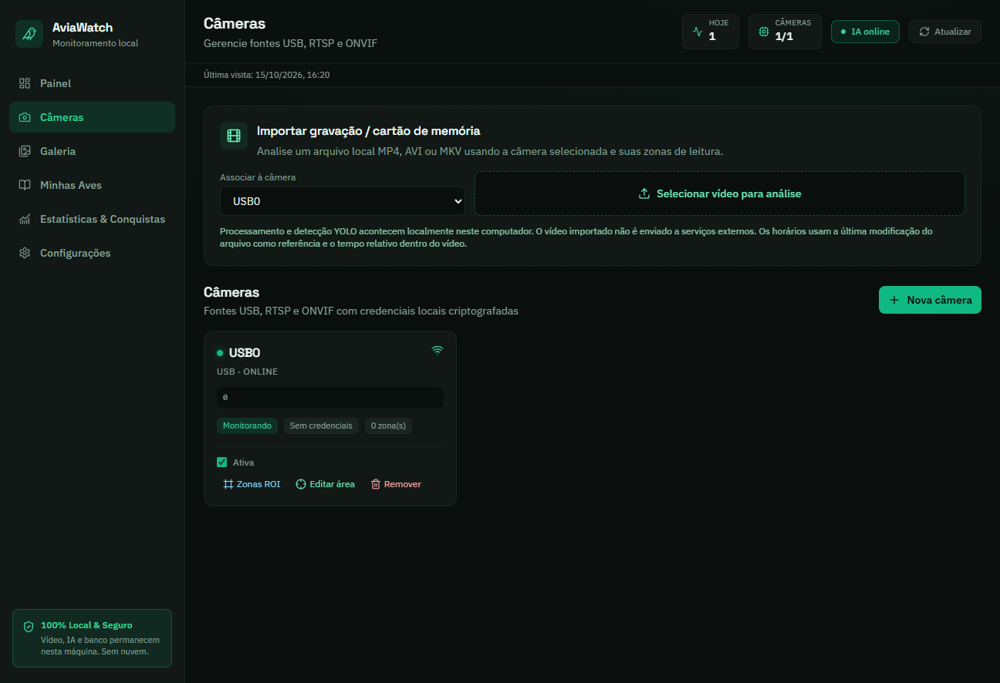
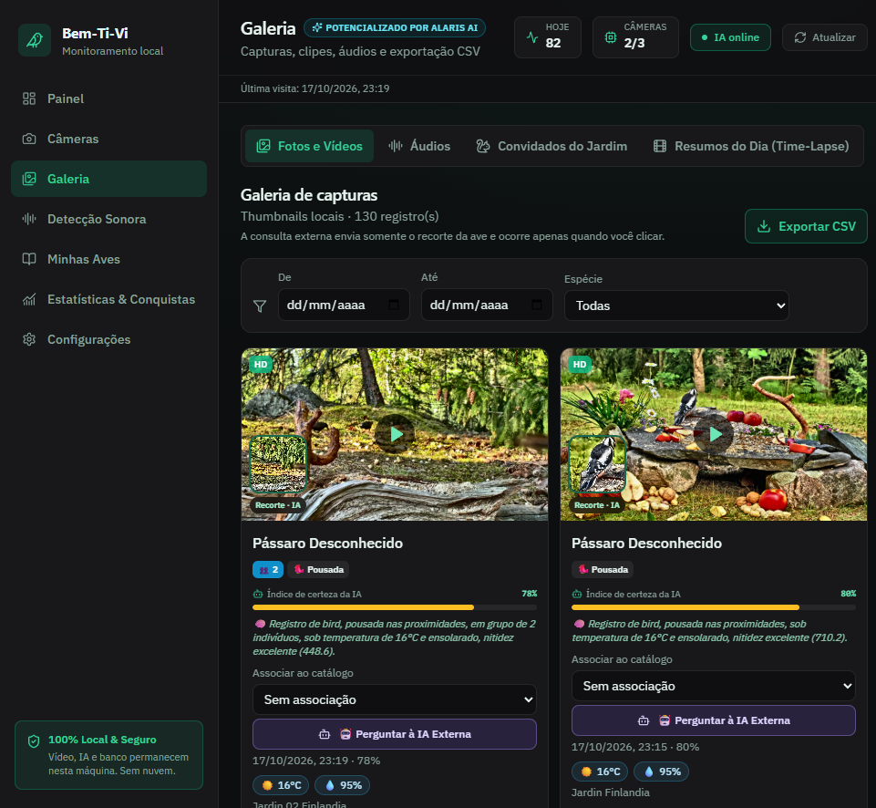
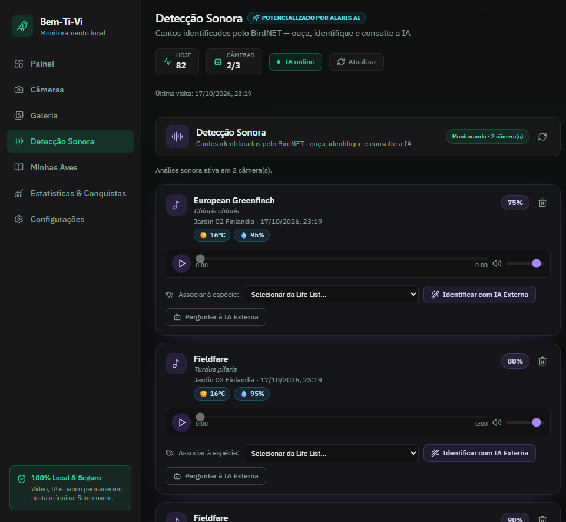
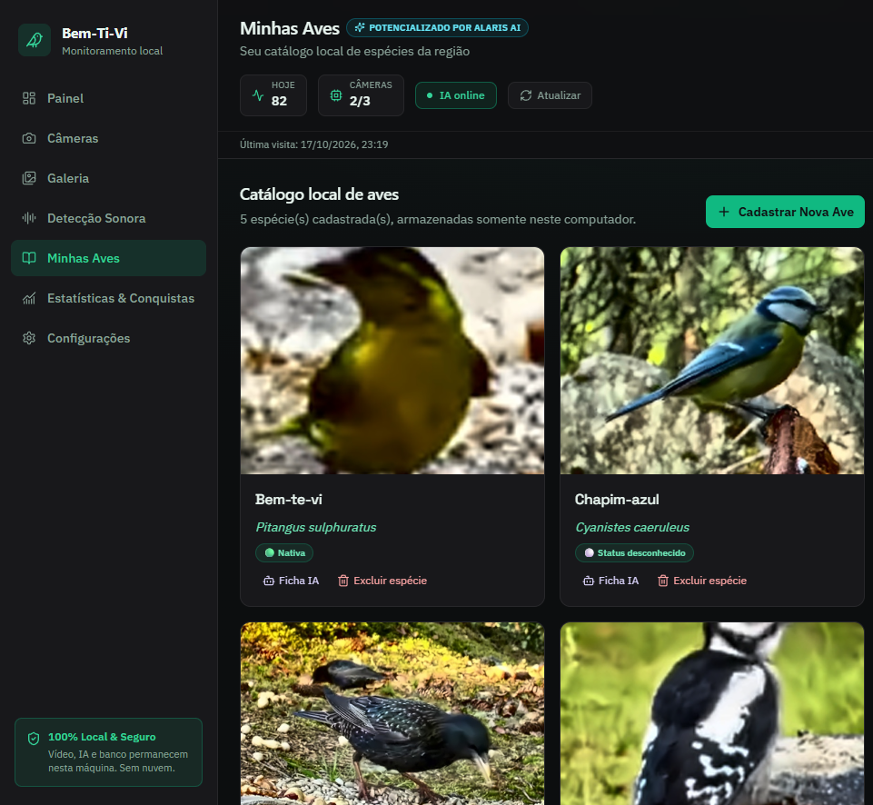
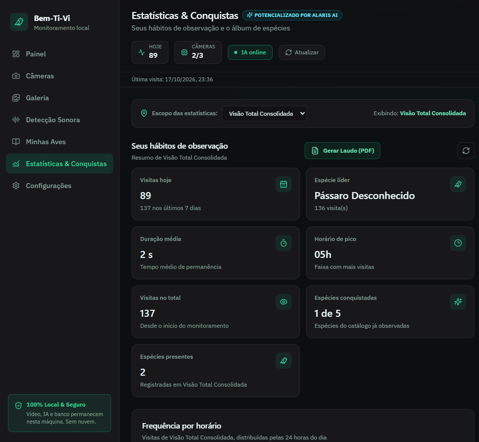
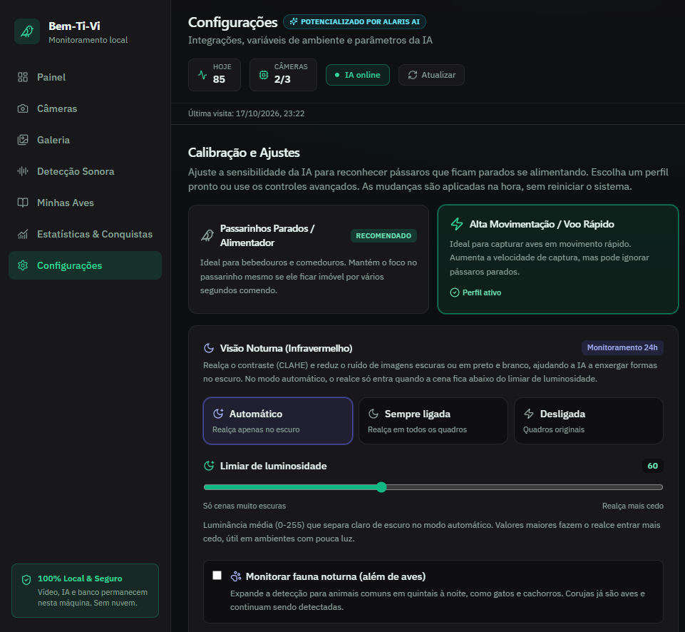

# Bem-Ti-Vi — Guia do Usuário

> **Para quem quer entender e usar o Bem-Ti-Vi sem precisar entender de programação.**
>
> (Se você é desenvolvedor e quer detalhes técnicos de instalação e configuração, veja o [`README.md`](README.md).)

---

## O que é o Bem-Ti-Vi?

O Bem-Ti-Vi é um **vigia de pássaros automático** para o seu computador. Você aponta uma
câmera (uma webcam ou uma câmera IP) para um comedouro, bebedouro ou cantinho onde os
passarinhos costumam aparecer, e o sistema **sozinho**:

- **percebe** quando um pássaro entra na imagem;
- **tira uma foto** e **grava um vídeo** da visita;
- **anota a hora** e guarda tudo no seu computador;
- e, se você quiser, **descobre o nome** do pássaro (pela imagem ou pelo canto).

Tudo acontece **na sua própria máquina**. Nada vai para a internet ou para a nuvem, exceto
quando você pede especificamente para uma inteligência artificial adivinhar o nome da ave.

**Resumindo:** é como ter um passarinho-fotógrafo que trabalha 24 horas por dia e nunca dorme. 🐦

---

## O que ele faz? (um resumo rápido)

| Função | O que acontece |
|--------|----------------|
| 📷 **Detecção de pássaros** | Reconhece um passarinho na câmera e inicia uma "visita" |
| 🌙 **Visão noturna** | Realça imagens escuras/infravermelho e monitora 24 horas |
| 🖼️ **Fotos e vídeos** | Guarda uma foto e um clipe curto de cada visita |
| 🎞️ **Resumo do dia** | Junta os clipes do dia em um vídeo acelerado (time-lapse) |
| 🔊 **Reconhecimento de canto** | Identifica o pássaro pelo som e organiza os cantos numa aba própria (opcional) |
| 🤖 **Identificação por IA** | Adivinha o nome da ave na foto (opcional, sob seu comando) |
| 📊 **Estatísticas** | Mostra horários de pico, ranking e gráficos |
| 🏆 **Lista de Vida e conquistas** | Você "desbloqueia" espécies como num jogo |
| 🌦️ **Clima** | Mostra o tempo e como ele influencia as visitas |
| 🔔 **Alertas** | Avisa no Telegram ou no Discord (opcional) |
| 📁 **Importar vídeos** | Analisa gravações antigas do cartão de memória |
| 📖 **Catálogo** | Cadastra as aves que você conhece |
| 📤 **Exportar dados** | Baixa uma planilha (CSV) com todas as visitas |

---

## Como instalar e abrir (o jeito mais simples)

1. Instale o **Python 3.11 ou superior** e o **Node.js 20 ou superior** (links no README técnico).
2. Dê um **duplo clique** no arquivo `start.bat`, dentro da pasta do projeto.
3. Espere algumas janelas abrirem. Na primeira vez, ele baixa o programa de detecção e pode demorar vários minutos.
4. O navegador deve abrir sozinho. Se não abrir, acesse:

   **http://127.0.0.1:5173**

   (Esse é o endereço do painel. Guarde-o nos favoritos.)

5. Para **fechar**, feche as duas janelas pretas que se abriram (ou aperte `Ctrl+C` em cada uma).

> **Importante:** o painel funciona apenas no seu próprio computador. Não é preciso internet para vigiar os pássaros — só para algumas funções opcionais (clima, IA externa e alertas).

---

## As telas do Bem-Ti-Vi

O menu lateral tem sete telas. Vamos explicar cada uma como se estivéssemos juntos:

---

### 🖥️ 1. Painel (a tela inicial)

É o "painel do cockpit". Aqui você vê, de relance:

- **Clima agora** — temperatura, chuva e vento, com um **seletor de localidade**:
  escolha a *localização global* ou o *clima local de cada jardim* (útil quando você
  acompanha câmeras de outros lugares).
- **Números do dia** — quantas visitas, quantas espécies, tempo médio e horário de
  movimento. Um seletor de **Jardim** filtra tudo para a câmera escolhida.
- **Ao vivo** — a imagem em tempo real das suas câmeras, em cartões translúcidos com
  botões de **ativar/desativar o monitoramento**, **ouvinte de áudio ao vivo** e
  **Bioacústica (BirdNET)** liga/desliga direto no cartão.
- **Top 5 espécies** — as aves mais frequentes do período, cada uma com a **foto**.
- **Visitas de hoje** — uma linha do tempo do dia; ao abrir um registro, o botão
  **🤖 Perguntar à IA Externa** dispara a análise **daquele pássaro específico**.
- **Gráfico de visitas** — a evolução ao longo dos dias.

**Para que serve:** ver "como está o movimento" sem precisar abrir nada.

---

### 📷 2. Câmeras

Onde você **cadastra e cuida** das câmeras.

- **Adicionar câmera:** escolha o tipo (webcam `USB`, ou câmera IP `RTSP`/`ONVIF`) e preencha o endereço e, se houver, usuário e senha.
- **Localização global (opcional):** para câmeras em outros países (lives do YouTube, streams externos), abra **Localização & fuso horário**, informe a **cidade/país** e toque em **Buscar**. O Bem-Ti-Vi descobre as coordenadas e o fuso sozinho — e o card da câmera passa a mostrar o **clima e o horário locais do jardim**.
- **Ligar/desligar** cada câmera com um toque.
- **Controles no cartão (ao vivo):** ligar/desligar a **IA (Alaris)**, ouvir o **áudio
  ao vivo** da câmera e ativar/desativar a **Bioacústica (BirdNET)** — em cartões
  translúcidos, sem sair do Painel.
- **Desenhar zonas** (veja abaixo).
- **Análise de Cartão de Memória** para analisar vídeos antigos (veja abaixo).

> **Excluir uma câmera não apaga nada da galeria.** As fotos, os clipes e os áudios já
> gravados daquele jardim são **preservados para sempre**; a câmera apenas sai da lista
> de monitoramento (o histórico continua disponível nas Galerias e nas Estatísticas).

**Para que serve:** dizer ao sistema *onde* olhar e *o que ignorar*.

#### 🟢 O que são "zonas de leitura"?

Imagine que a câmera aponta para o quintal inteiro, mas você só se importa com o comedouro.
Você desenha **zonas de inclusão** (áreas verdes) ao redor do comedouro: só ali o sistema
procura pássaros. Também dá para desenhar **zonas de exclusão** (vermelhas), por exemplo
uma árvore que balança com o vento e alarmaria à toa.

#### 🟦 E as "Zonas ROI"?

São a mesma ideia, mas em **retângulos** — mais rápidos de desenhar quando você só quer
"ficar de olho nesse quadradinho".

---

### 🖼️ 3. Galeria

O **álbum de fotos** dos seus pássaros. Aqui você:

- vê a foto e a miniatura de cada visita (as fotos tratadas automaticamente
  aparecem com o selo **HD**);
- confere o **recorte focado da ave** (close-up com a plumagem em detalhe),
  mostrado como miniatura **Recorte · IA** no canto do cartão — e **um clique nele
  já abre a Ficha Ornitológica (IA)** daquela ave, sem passo extra;
- **assiste ao clipe** gravado (clique na imagem ou em "Reproduzir clipe");
- **pergunta o nome** da ave clicando em **🤖 Perguntar à IA Externa** (se estiver configurada);
- abre a **🔎 Ficha ornitológica (IA)** de uma ave já identificada para uma consulta
  profunda (família, conservação, dieta, habitat, curiosidades e biogeografia);
- **associa a visita** a uma espécie do seu catálogo;
- **exporta tudo** numa planilha (CSV);
- **apaga** visitas que não quer mais.

**Para que serve:** rever, organizar e "etiquetar" os visitantes.

#### 🎞️ Abas da Galeria

No topo da Galeria há **quatro abas**, separando cada tipo de mídia:

- **Fotos e Vídeos** — as visitas individuais (foto, recorte e clipe);
- **Áudios** — a **galeria de cantos** do BirdNET (o mesmo painel da aba *Detecção Sonora*),
  com imagens/vídeos e áudios em **galerias separadas**;
- **Convidados do Jardim** — os visitantes que não são aves (esquilos, gatos…);
- **Resumos do Dia (Time-Lapse)** — os vídeos acelerados de cada dia.

#### 🎞️ Resumos do Dia (Time-Lapse)

Na aba **Resumos do Dia (Time-Lapse)**, o Bem-Ti-Vi junta os clipes de cada dia em **um
único vídeo acelerado**, para você rever os melhores momentos em segundos.

- o vídeo do dia já aparece pronto no player, com a data, a quantidade de clipes e a duração;
- clique em **Gerar resumo de hoje** para montar (ou refazer) o vídeo na hora;
- use **Baixar** para salvar o arquivo e **Excluir** para apagá-lo;
- a montagem acontece sozinha ao fim do dia — você não precisa fazer nada.

**Para que serve:** "passar o filme do dia" de forma rápida, sem assistir a cada gravação.

---

### 🔊 4. Detecção Sonora

A aba de **destaque** para quem gosta de "ouvir" o jardim. Aqui ficam os cantos
identificados pelo **BirdNET**, mostrados em **blocos de 5**, que você carrega aos
poucos clicando em **"Ver mais…"** (sem pular de página em página).

Cada canto é um cartão com:

- **Player de áudio integrado** — dê o play para ouvir o trecho gravado daquela
  detecção (barra de progresso, volume e mudo). Nada toca sozinho.
- **Associar à espécie** — um menu para **ligar o canto a uma ave da sua Life List**
  (Minhas Aves). Assim o canto entra na sua coleção.
- **Wand — Identificar com IA Externa** — envia o **sonograma** (a "impressão
  digital" visual do som) para a IA configurada e tenta descobrir a espécie,
  cadastrando-a automaticamente quando for nova.
- **Bot — Perguntar à IA Externa** — abre a **ficha ornitológica completa** da
  espécie já identificada (família, conservação, dieta, habitat, curiosidades…).
- **Lixeira** — remove aquela detecção do histórico.

No topo aparece o **estado** do monitoramento acústico (quantas câmeras estão sendo
ouvidas) e um botão para **atualizar** a lista na hora.

**Para que serve:** revisar, ouvir e identificar os cantos — inclusive aves que
aparecem pouco e você quase nunca vê.

#### ⚠️ Sobre os pássaros não identificados

Quando o sistema **não tem certeza** do nome do pássaro, ele **nunca** inventa: o
registro aparece rotulado como **"Pássaro Desconhecido"**, com uma **silhueta padrão**
no lugar da foto. É o mesmo rótulo em todo o aplicativo (Painel, Galeria, Álbum e
Estatísticas).

Os bichos que **não são pássaros** — esquilos, gatos, gambás — ficam **separados** na
aba **Visitantes Especiais** (no Painel) e em **Convidados do Jardim** (na Galeria), e
**não** entram na contagem de aves.

---

### 📖 5. Minhas Aves

O seu **catálogo pessoal de espécies**. Cadastre:

- o nome popular (ex.: "Bem-te-vi");
- o nome científico (ex.: *Pitangus sulphuratus*);
- observações e uma foto de referência.

Depois, na Galeria, você **associa** cada visita à espécie cadastrada. É isso que alimenta
sua Lista de Vida e suas estatísticas.

Clique em qualquer card (aqui ou no **Álbum de Conquistas**) para abrir a **ficha técnica**
da espécie: histórico de avistagens, **horários de pico** no comedouro, **temperatura média**
preferida (cruzada com o clima), notas científicas e o **status ecológico** (Nativa,
Migratória, Rara…). A miniatura do card mostra o **recorte tratado** da melhor visita e,
quando ainda não há foto, aparece a **silhueta padrão** — nunca um ícone de imagem quebrada.

**Para que serve:** montar a "coleção" de aves que você já registrou.

---

### 📊 6. Estatísticas & Conquistas

O "modo jogador". Um **seletor no topo** alterna o escopo entre **cada jardim** e a
**Visão Total Consolidada** (todos juntos). Aqui você encontra:

- **gráficos e horários de pico** — quando os pássaros mais aparecem (no jardim escolhido ou no total);
- **espécies presentes** — quantas espécies já passaram por aquele jardim;
- **Insights Comportamentais & Clima** — cards inteligentes e gráficos que cruzam o
  tempo com os hábitos das aves (veja abaixo);
- **Lista de Vida** — as espécies que você já desbloqueou, com foto e número de avistagens;
- **Conquistas** — medalhas que você ganha ao atingir marcos (ex.: registrar a 10ª espécie).

**Para que serve:** se divertir e aprender os hábitos dos seus visitantes.

---

### ⚙️ 7. Configurações

Onde você ajusta o comportamento. Tem cinco blocos:

1. **Alertas e Notificações** — liga/desliga os avisos e escolhe quando notificar (qualquer visita ou só espécies novas), com o token e o ID do chat do Telegram.
2. **Variáveis do ambiente** — segredos e chaves (Discord, IA externa).
3. **Calibração e Ajustes** — o "tempero" da IA e a **visão noturna** (veja abaixo).
4. **Preferências da IA e alertas** — quanto gravar, o limiar de confiança e se o reconhecimento de canto está ligado.
5. **Exclusão e limpeza de dados** — apagar visitas antigas ou tudo.

---

## Detalhes das funções mais importantes

### 🔍 Como o sistema "vê" o pássaro?

O Bem-Ti-Vi usa uma inteligência artificial chamada **YOLOv8**, treinada para reconhecer
objetos. Ele é ajustado para procurar apenas a classe **"pássaro"**. Quando detecta um, ele:

1. marca uma caixa ao redor do pássaro;
2. **inicia uma visita** e grava cerca de **6 segundos** — 3 s antes da chegada +
   3 s depois — para você ver o pássaro chegando, pousando e saindo;
3. escolhe sozinho o **melhor quadro** do vídeo (o mais nítido, com o pássaro bem
   enquadrado) e o **melhora automaticamente** (contraste + redução de ruído) antes
   de salvar como a **foto oficial em alta definição**;
4. guarda também um **clipe** curto em vídeo;
5. **mantém o registro** mesmo se o pássaro ficar parado comendo por alguns segundos.

Dá para ajustar o quanto a IA deve ser "confiante" para contar um pássaro (veja Calibração).

### 📸 A foto automática (melhor quadro em HD)

Você não precisa escolher o melhor momento: o Bem-Ti-Vi faz isso por você. Entre os
cerca de **6 segundos** de gravação de cada visita, ele analisa todos os quadros em
que o pássaro aparece e fica com o **mais nítido** — evitando fotos borradas de asa
em movimento — e ainda realça o contraste e reduz o ruído da imagem. Na Galeria,
essas fotos ganham um selo **HD** e passam a ser a foto de destaque no seu
**Álbum de Conquistas (Minhas Aves)**.

**Para que serve:** conseguir aquela foto bonita e nítida do pássaro, sem ter de
procurar o melhor instante manualmente.

### 🧠 A IA que conta bando, entende comportamento e conhece as espécies

O "cérebro" do Bem-Ti-Vi ficou bem mais esperto. Agora ele:

- **conta quantos pássaros** estão no comedouro ao mesmo tempo. Se chegarem 3
  cambacicas e 2 saíras juntas, ele registra isso e mostra um selo **👥 N** na foto;
- **distingue o que o pássaro está fazendo**: 🍽️ *Alimentando-se* (bico no
  comedouro), 🐦 *Pousada* (só descansando) ou ✈️ *Em movimento*;
- **conhece as espécies da nossa região** e coloca um selo em cada uma:
  🟢 Nativa, 🟡 Migratória, 🔵 Endêmica, ⭐ **Rara** ou 🟠 Exótica. Isso aparece em
  **Minhas Aves**, no **Álbum** e na **Galeria** — ótimo para quem acompanha aves
  raras e a conservação;
- **fica mais atento em dias ruins de luz**: quando chove, fica nublado ou
  escurece, ele automaticamente fica um pouquinho mais "desconfiado do contrário"
  — ou seja, aceita detectar o pássaro mesmo com a imagem mais apagada, para não
  perder o registro;
- **avisa quando uma ave volta**: se uma espécie que você não via há **mais de 6
  meses** aparecer de novo, o Bem-Ti-Vi cria um **alerta de reaparecimento** (uma
  "anomalia"), que pode ser visto na lista de anomalias da API/painel.

**Para que serve:** transformar o Bem-Ti-Vi num verdadeiro caderno de campo
automático — não só "tem um pássaro", mas *quantos*, *fazendo o quê* e *que
espécie* é, com foco em aves raras e migratórias.

> **Dica:** o contraste extra do comedouro e o modo "só registrar quando estiver
> comendo" são ajustes avançados. Por padrão, o sistema registra todas as visitas
> (mesmo as de quem só pousa) para você não perder nada.

### 🌙 Visão noturna e monitoramento 24 horas

O Bem-Ti-Vi também **enxerga no escuro**. Muitas câmeras têm visão infravermelha
(ficam em preto e branco à noite); o sistema realça o contraste dessas imagens
antes de procurar o pássaro, então ele continua detectando mesmo com pouca luz.

Na tela **Configurações → Calibração e Ajustes**, na seção **Visão Noturna
(Infravermelho)**, você escolhe:

- **Automático (recomendado):** só realça quando está escuro — de dia nada muda;
- **Sempre ligada:** realça em todos os momentos (bom para câmeras IR mais fracas);
- **Desligada:** usa a imagem original;
- **Monitorar fauna noturna:** além de aves, passa a detectar bichos comuns de quintal
  à noite, como **gatos e cachorros**. Corujas já são aves e continuam sendo detectadas.

Como você percebe que a visão noturna está ligada:

- no **Painel**, sobre o vídeo ao vivo aparece um ícone de lua 🌙 e um leve filtro azulado;
- na tela **Câmeras**, um selo **Visão noturna** no cartão da câmera;
- na **Galeria**, um selo **Noturno** nas fotos tiradas à noite.

**Para que serve:** não perder os bichos que só aparecem de madrugada.

### 🔊 Reconhecimento de canto (BirdNET)

Além da visão, o Bem-Ti-Vi pode **escutar** o ambiente e identificar o pássaro pelo canto,
usando um sistema chamado **BirdNET**. É opcional e precisa ser ativado nas Configurações.

- Funciona com o **microfone** da câmera USB ou com um microfone do computador.
- O sistema ouve pedacinhos de 3 segundos e tenta descobrir qual ave cantou.
- Acima de um nível de confiança (70% por padrão), a detecção é guardada.
- Se houver uma visita "visual" da mesma câmera até 30 segundos antes/depois, o sistema
  **liga o canto à imagem** — ou seja, ele tenta unir "o que você viu" com "o que você ouviu".
- Cada canto é gravado como um **clipe de áudio** e fica disponível na aba
  **🔊 Detecção Sonora**, onde você pode **ouvir**, **associar a uma espécie** da sua
  Life List, **identificar pela IA** ou **abrir a ficha** da espécie.

> **Detalhe técnico:** o áudio nunca sai do seu computador. O reconhecimento é feito localmente.

### 🤖 Identificação por IA externa (perguntar o nome)

Quando você clica em **🤖 Perguntar à IA Externa** numa foto, o Bem-Ti-Vi envia **aquela foto**
para um serviço de inteligência artificial (como a OpenAI, OpenRouter, Groq, Ollama ou Gemini)
e pergunta: *"Que espécie é essa?"* Ele responde com o nome comum e o científico.

**Pontos importantes:**

- Só acontece **quando você clica**. Nada é enviado sozinho.
- É preciso **configurar uma chave** de algum provedor (nas Configurações).
- O Bem-Ti-Vi aceita vários provedores. No card "IA Externa" você escolhe o **provedor** numa
  lista e o **modelo** é sugerido automaticamente — não precisa digitar endereço nenhum.
- A foto fica guardada no seu computador e é enviada apenas durante essa consulta.
- O Bem-Ti-Vi envia a **foto tratada** (a melhor versão da ave, já realçada e recortada).
- Ao identificar, a espécie é **cadastrada sozinha no Catálogo (Life List)** e a visita já fica
  associada a ela — assim a ave aparece no Álbum de Conquistas com a melhor foto disponível.
- Depois de identificada, use **🔎 Ficha ornitológica (IA)** (na Galeria) ou
  **Perguntar à IA Externa** (no detalhe da visita) para pedir uma **ficha completa**
  da espécie: nome científico, família, status de conservação, dieta, comportamento
  alimentar, habitat, distribuição, dados biogeográficos, porte e curiosidades. O
  resultado aparece num painel organizado e fica guardado para não repetir consultas
  (use **Atualizar** para refazer).
- A mesma ficha também está em **Minhas Aves**: use o botão **Ficha IA** no cartão da
  ave (ou abra a ficha técnica dela e toque em **🔎 Ficha ornitológica (IA)**). Aqui a
  consulta parte da espécie cadastrada e da **foto de referência**, e o resultado fica
  guardado na própria espécie.
- Se a espécie **já estava** no seu catálogo, o Bem-Ti-Vi **não duplica** o card: apenas
  soma mais uma visita e guarda a nova foto/vídeo naquela espécie.

### 🌦️ Clima e estatísticas

O Bem-Ti-Vi consulta o tempo no seu endereço (via Open-Meteo) e cruza com as visitas.
Assim você descobre, por exemplo, se choveu mais no dia em que os pássaros sumiram.

**Câmeras em outros países:** se você cadastrou a localização de uma câmera
remota (aba **Câmeras → Localização & fuso horário**), o card dela mostra o
**clima e o horário do jardim** naquele instante — pode ser sol lá enquanto é
noite aqui. Os **gráficos de horário de pico** também passam a usar o **fuso
local da câmera**, então as visitas aparecem na hora certa do jardim.

Na aba **Estatísticas**, a seção **Insights Comportamentais & Clima** mostra tudo isso
de forma automática, em cards e gráficos fáceis de ler:

- 🌡️ **Faixa de temperatura preferida** — qual temperatura atrai mais espécies
  diferentes (com um gráfico interativo: alterne entre *Visitas*, *Espécies* e
  *Visitas/dia*);
- 🌧️ **Chuva × tempo seco** — se aparecem mais aves em dias de chuva ou de tempo firme;
- ⏰ **Horário no frio × no calor** — a que horas as aves costumam aparecer em cada caso;
- 🐦 **Horário por espécie** — quanto cada ave chega mais cedo ou mais tarde conforme
  a temperatura (ex.: *"os beija-flores aparecem mais cedo quando está mais quente"*).

Quanto mais dias de observação você tiver, mais espertos ficam os insights.

### 🔔 Alertas no Telegram e no Discord

Se você quiser ser avisado, é possível mandar um alerta quando um pássaro aparece.
Na tela **Configurações** existe a seção **Alertas e Notificações**, com tudo num lugar só:

- **Alertas habilitados:** liga ou desliga o envio de avisos.
- **Quando notificar:** escolha entre **Qualquer visita** (avisa sempre) ou **Apenas novas
  espécies** (avisa só quando aparece uma ave que ainda não está no seu catálogo *Minhas Aves* —
  ideal para quem quer descobrir espécies novas sem ser incomodado pelas já conhecidas).
- **Token do bot do Telegram:** você cria um bot no Telegram (falando com o `@BotFather`) e cola
  o "token" que ele entrega.
- **ID do chat do Telegram:** o número da conversa/grupo que vai receber os avisos.
- **Testar Envio de Mensagem:** envia um alerta de teste na hora e mostra se deu certo, sem
  precisar esperar um pássaro aparecer.

O alerta chega com o **nome da espécie**, o **horário** e a **foto** da visita.
No **Discord**, em vez do bot, você cria um "webhook" no seu servidor e cola o endereço.

Há também um **limiar de confiança** para notificar: você escolhe só receber alertas quando a
IA estiver bem certa (ou avisa até as duvidosas).

### 📁 Importar vídeos antigos (cartão de memória)

Tem gravações antigas de uma câmera? Dá para analisar:

1. Copie o vídeo (MP4, AVI, MOV ou MKV, até 2 GB) para o computador.
2. Em **Câmeras → Análise de Cartão de Memória**, escolha a câmera e **arraste o
   arquivo** para a área pontilhada (ou clique para selecionar). Pode soltar vários
   de uma vez.
3. O sistema analisa o vídeo **no seu computador** (não envia nada para a internet) e
   cria visitas e fotos automaticamente. Uma **barrinha de progresso** mostra o andamento
   e continua aparecendo mesmo se você trocar para a Galeria e voltar.
4. Ao terminar, aparece um cartão dizendo quantos pássaros foram encontrados (ex.:
   **🐦 3 Pássaros Encontrados**), com as melhores fotos. Clique em **Ver na Galeria**
   para assistir aos trechos.
5. As zonas que você desenhou naquela câmera são usadas para ignorar áreas indesejadas.

---

## Calibração: o "tempero" da IA

Na tela **Configurações → Calibração e Ajustes**, você escolhe o equilíbrio entre
"pegar tudo" e "não ter falsos alarmes". Há dois **perfis prontos** (aplicados com um clique):

| Perfil | Indicado para |
|--------|--------------|
| **Passarinhos Parados / Alimentador** (recomendado) | Comedouros e bebedouros, onde o pássaro fica parado comendo |
| **Alta Movimentação / Voo Rápido** | Aves em movimento rápido |

Se quiser ajustar na mão, há cinco controles com explicação ao lado:

- **Sensibilidade da IA** — quanto mais sensível, mais fácil detectar (mas pode dar mais falsos alarmes).
- **Tempo de permanência imóvel** — quanto tempo a visita continua mesmo com o pássaro parado.
- **Sensibilidade de movimento** — quanto movimento é preciso para a IA começar a procurar.
- **Tempo de presença da ave** — quanto tempo a ave precisa **sumir** para o sistema entender que aquela visita terminou (anti-spam: mesma ave = um só registro).
- **Intervalo mínimo entre alertas** — a pausa mínima entre um alerta e o próximo na mesma zona, para não encher o Telegram/Discord.

A mesma tela traz a **Visão Noturna (Infravermelho)**, com o modo (automático,
sempre ligada ou desligada), o limiar de luminosidade e a opção de monitorar a
fauna noturna além de aves (veja 🌙 acima).

**As mudanças são aplicadas na hora, sem reiniciar nada.**

---

## Perguntas frequentes (FAQ)

**Preciso de internet para vigiar os pássaros?**
Não. A detecção e a gravação funcionam totalmente offline. Só o clima, a identificação por IA e os alertas precisam de internet.

**Meus vídeos e fotos ficam na internet?**
Não. Tudo fica na pasta do programa no seu computador. Só a foto que você pedir para identificar é enviada ao provedor de IA, e somente nesse momento.

**O sistema sabe o nome dos pássaros sozinho?**
Não automaticamente. Ele detecta e registra. Para saber o nome, você pode (a) associar manualmente no catálogo, ou (b) clicar em "Perguntar à IA Externa" (se configurada), ou (c) ativar o reconhecimento de canto.

**Posso usar uma câmera IP / câmera de segurança?**
Sim, via RTSP ou ONVIF. Basta informar o endereço e as credenciais.

**Funciona de noite, com a câmera em preto e branco (infravermelho)?**
Sim. O Bem-Ti-Vi realça o contraste dessas imagens escuras e continua detectando. Na tela
**Configurações** você ainda pode ligar a **Visão Noturna** e até monitorar a fauna noturna
(gatos, cachorros) além de aves.

**Apaguei sem querer. Como recuperei?**
Se o arquivo estiver na Lixeira do computador, você pode restaurá-lo. Se excluiu dentro do Bem-Ti-Vi, o registro e os arquivos locais são removidos.

**O que é a "Lista de Vida"?**
É uma lista de todas as espécies que você já registrou. Cada nova espécie desbloqueada vira uma "conquista".

---

## Dicas de ouro 🌟

1. **Aponte bem a câmera** para o comedouro e evite fundos muito movimentados.
2. **Desenhe zonas de inclusão** só no comedouro para não contar o vento e os galhos.
3. **Use um perfil pronto** antes de ajustar na mão — funciona bem na maioria dos casos.
4. **Cadastre seu catálogo** com as aves da sua região: isso deixa a Galeria e as estatísticas muito mais úteis.
5. **Ative o reconhecimento de canto** se quiser descobrir aves que aparecem pouco ou só de noite.

---

## Segurança e privacidade

- O Bem-Ti-Vi foi feito para rodar **só no seu computador**.
- As chaves (Telegram, Discord, IA) são guardadas num arquivo local e **nunca são mostradas** na tela — a tela exibe apenas um começo mascarado, como `AIza...****`.
- O painel de configuração só aceita acesso do próprio computador (não funciona pela internet).
- Por padrão, **toda** a API só responde ao seu computador. Para acessar de outro aparelho seria preciso mudar uma opção avançada (`ALLOW_REMOTE_ACCESS`) — e o recomendado, nesse caso, é usar uma VPN.
- Não há telemetria: o programa não "espiona" você.

> **Guarde bem** a pasta do programa e o arquivo de segredos. Ele contém suas senhas de integração.

---

## Preciso de ajuda?

Se algo não funcionar, veja a tabela de **Solução de problemas** no [`README.md`](README.md) ou
abra uma conversa sobre o projeto. E lembre-se: **nenhum dado seu sai do computador sem a sua permissão**.
