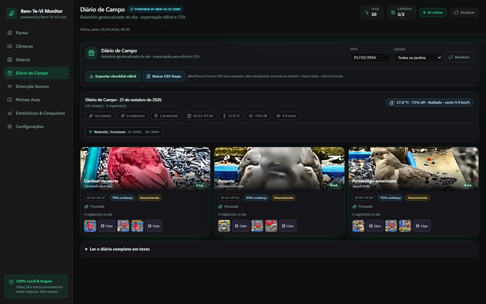

# Bem-Te-Vi Monitor — Guia do Usuário

> **Bem-Te-Vi Monitor** é o seu vigia de pássaros automático: um painel de
> monitoramento de vida silvestre que roda **100% na sua máquina**, sem nuvem e
> sem mensalidade.
>
> Por trás dele, o **Bem-Te-Vi Core** — o motor de inteligência artificial —
> reconhece aves, identifica espécies, organiza a sua coleção e aprende com
> cada visita. Você acompanha tudo por uma interface clara, em português.

| | |
|---|---|
| 🖥️ **Bem-Te-Vi Monitor** | A aplicação: painel, galeria, diário de campo, estatísticas e configurações. |
| 🧠 **Bem-Te-Vi Core** | O motor: visão computacional (YOLOv8), re-identificação de espécies e indivíduos, aprendizado ativo, bioacústica (BirdNET) e leitura do clima. |

> **Para quem quer entender e usar o Bem-Te-Vi Monitor no dia a dia.**
>
> (Se você é desenvolvedor e quer detalhes técnicos de instalação e configuração, veja o [`README-DEV.md`](README-DEV.md).)

---

## Índice

- [O que é o Bem-Te-Vi Monitor?](#o-que-é-o-bem-te-vi-monitor)
- [O que ele faz?](#o-que-ele-faz-um-resumo-rápido)
- [Como instalar e abrir](#como-instalar-e-abrir-o-jeito-mais-simples)
- [As telas do Bem-Te-Vi Monitor](#as-telas-do-bem-te-vi-monitor)
  - Painel · Câmeras · Galeria · Diário de Campo · Detecção Sonora · Minhas Aves · Estatísticas e Conquistas · Configurações
- [Detalhes das funções mais importantes](#detalhes-das-funções-mais-importantes)
  - [Identificação automática de espécie](#-identificação-automática-de-espécie-bem-te-vi-core)
  - [Deep-Dive da visita](#-deep-dive-da-visita-o-raio-x-de-cada-visita)
  - [Recorte HD (Crop)](#-recorte-hd-crop)
  - [Resumo Matinal](#-resumo-matinal-bom-dia-das-aves)
  - [Laudo Ornitológico em PDF](#-laudo-ornitológico-em-pdf)
  - [Visitantes Especiais](#-visitantes-especiais-o-modo-esquilo)
  - [Conhecidos do Jardim](#-conhecidos-do-jardim-re-identificação-individual)
  - [Ensinar o Bem-Te-Vi Core](#-ensinar-o-bem-te-vi-core-aprendizado-ativo)
- [Calibração: o "tempero" da IA](#calibração-o-tempero-da-ia)
- [Perguntas frequentes (FAQ)](#perguntas-frequentes-faq)
- [Dicas de ouro](#dicas-de-ouro)
- [Segurança e privacidade](#segurança-e-privacidade)
- [Preciso de ajuda?](#preciso-de-ajuda)

---

## O que é o Bem-Te-Vi Monitor?

O **Bem-Te-Vi Monitor** é um **vigia de pássaros automático** para o seu computador.
Você aponta uma câmera (uma webcam ou uma câmera IP) para um comedouro, bebedouro
ou cantinho onde os passarinhos costumam aparecer, e o sistema **sozinho**:

- **percebe** quando um pássaro entra na imagem;
- **tira uma foto** e **grava um vídeo** da visita;
- **anota a hora** e guarda tudo no seu computador;
- **descobre o nome** da ave sozinho, comparando a foto com o seu catálogo;
- e, se quiser, **confirma o nome** pelo canto (bioacústica) ou por uma
  inteligência artificial externa.

Tudo acontece **na sua própria máquina**. Nada vai para a internet ou para a nuvem, exceto
quando você pede especificamente para uma inteligência artificial adivinhar o nome da ave.

**Resumindo:** é como ter um passarinho-fotógrafo que trabalha 24 horas por dia e nunca dorme. 🐦

---

## O que ele faz? (um resumo rápido)

| Função | O que acontece |
|--------|----------------|
| 📷 **Detecção de pássaros** | Reconhece um passarinho na câmera e inicia uma "visita" |
| 🧠 **Identificação automática (Bem-Te-Vi Core)** | Compara a foto com as fotos de "Minhas Aves" e **nomeia a ave sozinho** (≥ 65% de similaridade) |
| 🏷️ **Reclassificação com aprendizado** | Se a associação errar, um clique corrige a espécie e a foto vai para a pasta de retreinamento |
| 🌙 **Visão noturna** | Realça imagens escuras/infravermelho e monitora 24 horas |
| 🖼️ **Fotos e vídeos** | Guarda uma foto e um clipe curto de cada visita |
| 📥 **Recorte HD (Crop)** | Baixa o close-up da ave em alta resolução, pronto para compartilhar |
| 🔍 **Deep-Dive da visita** | Abre o "Raio-X" de uma visita: nitidez, confiança, clima, bando e comportamento |
| 🐦 **Conhecidos do Jardim** | Reconhece o **indivíduo** que voltou (assinatura visual) e mostra o histórico dele |
| 🧾 **Laudo Ornitológico (PDF)** | Gera um relatório em PDF com fotos, clima, coordenadas e espécies |
| 🌅 **Resumo Matinal** | De manhã, manda no Telegram/Discord o resumo do dia anterior com a foto de destaque |
| 🎞️ **Resumo do dia** | Junta os clipes do dia em um vídeo acelerado (time-lapse) |
| 🔊 **Reconhecimento de canto** | Identifica o pássaro pelo som e organiza os cantos numa aba própria (opcional) |
| 🎼 **Espectrograma do canto** | Mostra o gráfico de frequência do canto ao lado do player e permite comparar as ondas sonoras |
| 🌙 **Viajantes Noturnos (NFC)** | Escuta noturna de migração (22:00–05:00): reduz o limiar do BirdNET para captar chamados de voo curtos de aves migrantes; aba dedicada com selo NFC |
| 📔 **Diário de Campo** | Monta o relatório do dia com clima, coordenadas, fotos e clipes — e exporta para o eBird ou CSV |
| 🐿️ **Visitantes Especiais** | Detecta esquilos, gatos e companhia e registra separado, sem contaminar a contagem de aves |
| 🌐 **Feed Global Bem-Te-Vi Monitor** | Mostra em tempo real os avistamentos raros das outras câmeras e jardins conectados |
| 🤖 **Identificação por IA** | Adivinha o nome da ave na foto (opcional, sob seu comando) |
| 📊 **Estatísticas** | Mostra horários de pico, ranking e gráficos |
| 🏆 **Lista de Vida e conquistas** | Você "desbloqueia" espécies como num jogo |
| 🌦️ **Clima** | Mostra o tempo e como ele influencia as visitas |
| 🔮 **Previsão de alimentação** | Antecipa a chuva no seu jardim e estima se a atividade das aves vai aumentar ou diminuir |
| 🌍 **Radar Global de Jardins** | Mapa-múndi com todos os jardins; um clique abre o clima, o vídeo ao vivo e as espécies daquele lugar |
| 🏅 **Momentos Raros** | Curadoria automática das fotos mais nítidas e das espécies raras, com download em "foto de postal" |
| 🎬 **Gerador de Reels** | Cria vídeos verticais (9:16, 1080×1920) com marca d'água, espécie e temperatura — prontos para Instagram Reels, TikTok e YouTube Shorts |
| 🔔 **Alertas** | Avisa no Telegram ou no Discord (opcional) |
| 📁 **Importar vídeos** | Analisa gravações antigas do cartão de memória |
| 📖 **Catálogo** | Cadastra as aves que você conhece |
| 📤 **Exportar dados** | Baixa uma planilha (CSV) com todas as visitas |
| 🖥️ **Aplicação desktop** | O mesmo painel empacotado em janela nativa (Tauri), com ícone próprio no Windows |

> **Detalhe honesto:** a identificação automática funciona **localmente**, com
> redes neurais embarcadas (MobileNetV3-Small) e, se não houver GPU nem
> internet, um descritor de cor/textura (OpenCV). Você não precisa pagar
> nada nem enviar foto nenhuma para que o sistema aprenda a reconhecer as
> aves do seu jardim.

---

## Como instalar e abrir (o jeito mais simples)

1. Instale o **Python 3.11 ou superior** e o **Node.js 20 ou superior** (links e detalhes no [`README-DEV.md`](README-DEV.md)).
2. Dê um **duplo clique** no arquivo `start.bat`, dentro da pasta do projeto.
3. Espere algumas janelas abrirem. Na primeira vez, o `start.bat` **instala as dependências
   sozinho** (basta ter internet) e baixa o programa de detecção — pode demorar vários minutos.
   Nas próximas vezes ele abre em segundos e só reinstala algo se o projeto for atualizado.
4. O navegador deve abrir sozinho. Se não abrir, acesse:

   **http://127.0.0.1:5173**

   (Esse é o endereço do painel. Guarde-o nos favoritos.)

5. Para **fechar**, feche as duas janelas pretas que se abriram (ou aperte `Ctrl+C` em cada uma).

> **Importante:** o painel funciona apenas no seu próprio computador. Não é preciso internet para vigiar os pássaros — só para algumas funções opcionais (clima, IA externa e alertas).

### 🖥️ Preferir uma janela de aplicativo?

O mesmo painel pode ser empacotado como **aplicativo desktop** (Tauri), com
ícone próprio no Windows e janela nativa:

```bat
cd Bem-Te-Vi\front
cargo tauri dev      :: janela de desenvolvimento
cargo tauri build    :: instalador pronto em front\src-tauri\target\release\bundle
```

Detalhes (Rust, toolchain e variáveis de ambiente) no
[`README-DEV.md`](README-DEV.md#aplicação-desktop-tauri--bem-te-vi-monitor).

### 🔗 Links diretos para cada tela

Cada tela tem um endereço próprio — é só acrescentar `#galeria`, `#cameras`,
`#species`… no fim da URL. Serve para favoritar uma aba específica e para
abrir links direto para a tela desejada.

---

## As telas do Bem-Te-Vi Monitor

O menu lateral tem **oito telas**. Vamos explicar cada uma como se estivéssemos juntos:

---

### 🖥️ 1. Painel (a tela inicial)

É o "painel do cockpit". Aqui você vê, de relance:

- **Clima agora** — temperatura, chuva e vento, com um **seletor de localidade**:
  escolha a *localização global* ou o *clima local de cada jardim* (útil quando você
  acompanha câmeras de outros lugares).
- **Números do dia** — quantas visitas, quantas espécies, tempo médio e horário de
  movimento. Um seletor de **Jardim** filtra tudo para a câmera escolhida.
- **Ao vivo** — a imagem em tempo real das suas câmeras, em cartões translúcidos com
  botões de **ativar/desativar o monitoramento**, **ouvinte de áudio ao vivo** e
  **Bioacústica (BirdNET)** liga/desliga direto no cartão.
- **Top 5 espécies** — as aves mais frequentes do período, cada uma com a **foto**.
- **Visitas de hoje** — uma linha do tempo do dia; ao abrir um registro, o botão
  **🤖 Perguntar à IA Externa** dispara a análise **daquele pássaro específico**.
- **Gráfico de visitas** — a evolução ao longo dos dias.
- **Motor do Bem-Te-Vi Core** — FPS, latência, modelo em uso e memória da máquina.
- **Logs cognitivos** — o que a IA "pensou" em cada ciclo (auto-calibração,
  bando, comportamento, species identificada).

**Para que serve:** ver "como está o movimento" sem precisar abrir nada.


---

### 📷 2. Câmeras

Onde você **cadastra e cuida** das câmeras.

- **Adicionar câmera:** escolha o tipo — webcam `USB`, câmera IP `RTSP`/`ONVIF`,
  stream `HLS`/`HTTP`/`WebRTC` ou **live do YouTube** (basta colar o link) — e
  preencha o endereço e, se houver, usuário e senha. As credenciais ficam
  **criptografadas** no seu computador (nunca em texto puro).
- **Localização global (opcional):** para câmeras em outros países (lives do YouTube, streams externos), abra **Localização & fuso horário**, informe a **cidade/país** e toque em **Buscar**. O Bem-Te-Vi descobre as coordenadas e o fuso sozinho — e o card da câmera passa a mostrar o **clima e o horário locais do jardim**.
- **Ligar/desligar** cada câmera com um toque.
- **Radar Global de Jardins:** no topo da aba, alterne entre **Grade** e **Radar Global** para ver todas as câmeras com localização em um mapa-múndi. Clique em um marcador para abrir, ali mesmo, o **clima local**, o **vídeo ao vivo**, as **estatísticas de hoje** e as **espécies** daquele jardim. Câmeras sem latitude/longitude não aparecem no mapa (o painel avisa quantas ficaram de fora).
- **Controles no cartão (ao vivo):** ligar/desligar a **IA (Bem-Te-Vi Core)**, ouvir o **áudio
  ao vivo** da câmera e ativar/desativar a **Bioacústica (BirdNET)** — em cartões
  translúcidos, sem sair do Painel.
- **Desenhar zonas** (veja abaixo).
- **Análise de Cartão de Memória** para analisar vídeos antigos (veja abaixo).

> **Excluir uma câmera não apaga nada da galeria.** As fotos, os clipes e os áudios já
> gravados daquele jardim são **preservados para sempre**; a câmera apenas sai da lista
> de monitoramento (o histórico continua disponível nas Galerias e nas Estatísticas).

**Para que serve:** dizer ao sistema *onde* olhar e *o que ignorar*.


#### 🟢 O que são "zonas de leitura"?

Imagine que a câmera aponta para o quintal inteiro, mas você só se importa com o comedouro.
Você desenha **zonas de inclusão** (áreas verdes) ao redor do comedouro: só ali o sistema
procura pássaros. Também dá para desenhar **zonas de exclusão** (vermelhas), por exemplo
uma árvore que balança com o vento e alarmaria à toa.

#### 🟦 E as "Zonas ROI"?

São a mesma ideia, mas em **retângulos** — mais rápidos de desenhar quando você só quer
"ficar de olho nesse quadradinho".

---

### 🖼️ 3. Galeria

O **álbum de fotos** dos seus pássaros. Aqui você:

- vê a foto e a miniatura de cada visita (as fotos tratadas automaticamente
  aparecem com o selo **HD**);
- confere o **recorte focado da ave** (close-up com a plumagem em detalhe),
  mostrado como miniatura **Recorte · IA** no canto do cartão — e **um clique nele
  já abre a Ficha Ornitológica (IA)** daquela ave, sem passo extra;
- **assiste ao clipe** gravado (clique na imagem ou em "Reproduzir clipe");
- **baixa o recorte em alta definição** com **📥 Baixar Recorte HD (Crop)** — o
  close-up é reescalado, realçado e salvo em JPEG, pronto para compartilhar;
- **confirma a identificação** com um clique em **Confirmar detecção** (o
  Bem-Te-Vi Core passa a tratar aquela ave como exemplo bom do nome);
- **corrige a associação** com **↻ Associação Incorreta / Reclassificar**: um
  modal lista as espécies do seu catálogo, você escolhe a certa e o recorte é
  guardado na pasta de **retreinamento** (``app-data/fine_tuning/``) para o
  modelo ficar ainda melhor;
- **pergunta o nome** da ave clicando em **🤖 Perguntar à IA Externa** (se estiver configurada);
- abre a **🔎 Ficha ornitológica (IA)** de uma ave já identificada para uma consulta
  profunda (família, conservação, dieta, habitat, curiosidades e biogeografia);
- **associa a visita** a uma espécie do seu catálogo;
- **filtra** o histórico por **período** e por **espécie**;
- **gera um Reel vertical** (9:16) da visita, pronto para redes sociais;
- **exporta tudo** numa planilha (CSV);
- **apaga** visitas que não quer mais.

Cada cartão traz um selo de identificação que explica **como** a ave foi
reconhecida: **Identificado pelo Bem-Te-Vi Core** (associação automática por
similaridade visual) ou **Espécie Confirmada** (você mesmo confirmou).

**Para que serve:** rever, organizar e "etiquetar" os visitantes.


#### 🎞️ Abas da Galeria

No topo da Galeria há **cinco abas**, separando cada tipo de mídia:

- **Fotos e Vídeos** — as visitas individuais (foto, recorte e clipe);
- **Momentos Raros** — a curadoria automática das fotos mais nítidas e das
  espécies raras/incomuns (veja abaixo);
- **Áudios** — a **galeria de cantos** do BirdNET (o mesmo painel da aba *Detecção Sonora*),
  com imagens/vídeos e áudios em **galerias separadas**;
- **Convidados do Jardim** — os visitantes que não são aves (esquilos, gatos…);
- **Resumos do Dia (Time-Lapse)** — os vídeos acelerados de cada dia.

#### 🏅 Momentos Raros · Fotos de Postal

Uma sub-aba dedicada a **descobrir as melhores fotos** do seu jardim, sem você
precisar procurar. O **Bem-Te-Vi Core** mede a **nitidez** de cada captura
(variância do Laplaciano, o mesmo critério usado para escolher o melhor quadro) e
combina com a **raridade da espécie** no seu histórico — 1 ou 2 avistagens já
valem um selo **Rara**.

- a **foto da semana** abre como uma capa de revista, com espécie, data e jardim;
- as demais formam uma **grade de revista**, cada uma com o selo de raridade e a
  **nota de nitidez**;
- escolha o período (**7, 14 ou 30 dias**) e use **Atualizar curadoria** para
  avaliar as fotos novas na hora (a varredura também roda sozinha, de tempo em tempo);
- clique em **Baixar postal** para salvar uma versão pronta para compartilhar:
  **moldura elegante, legenda com o nome (popular e científico), data, jardim e a
  marca d'água oficial Bem-Te-Vi** — gerada na hora, no seu computador.

**Para que serve:** guardar e compartilhar as visitas mais especiais sem garimpar
a galeria inteira.

#### 🎞️ Resumos do Dia (Time-Lapse)

Na aba **Resumos do Dia (Time-Lapse)**, o Bem-Te-Vi junta os clipes de cada dia em **um
único vídeo acelerado**, para você rever os melhores momentos em segundos.

- o vídeo do dia já aparece pronto no player, com a data, a quantidade de clipes e a duração;
- clique em **Gerar resumo de hoje** para montar (ou refazer) o vídeo na hora;
- use **Baixar** para salvar o arquivo e **Excluir** para apagá-lo;
- a montagem acontece sozinha ao fim do dia — você não precisa fazer nada.

**Para que serve:** "passar o filme do dia" de forma rápida, sem assistir a cada gravação.

---

### 📔 4. Diário de Campo

A aba **Diário de Campo** escreve o "caderninho de campo" do dia para você:

- escolha a **data** e, se quiser, um **jardim** específico;
- veja o **clima** (Open-Meteo), as **coordenadas** da câmera, os horários de
  primeira e última observação e as **fotos/clipes** de cada espécie;
- clique em **Ler o diário completo em texto** para copiar ou imprimir;
- use **Exportar checklist eBird** para baixar o arquivo no **eBird Record
  Format** (Cornell Lab of Ornithology), sem cabeçalho e com data mês/dia/ano —
  pronto para enviar à ciência cidadã;
- use **Baixar CSV limpo** para uma planilha simples em português.

**Para que serve:** transformar o histórico do jardim em um relatório bonito e
em dados que biólogos e observadores podem compartilhar com o mundo.



### 🔊 5. Detecção Sonora

A aba de **destaque** para quem gosta de "ouvir" o jardim. Aqui ficam os cantos
identificados pelo **BirdNET**, mostrados em **blocos de 5**, que você carrega aos
poucos clicando em **"Ver mais…"** (sem pular de página em página).

Cada canto é um cartão com:

- **Player de áudio integrado** — dê o play para ouvir o trecho gravado daquela
  detecção (barra de progresso, volume e mudo). Nada toca sozinho.
- **Espectrograma ao lado do player** — o gráfico de **frequência × tempo** do
  canto é gerado e salvo automaticamente; clique na imagem para ampliar e
  comparar visualmente as ondas sonoras de cada ave.
- **Associar à espécie** — um menu para **ligar o canto a uma ave da sua Life List**
  (Minhas Aves). Assim o canto entra na sua coleção.
- **Wand — Identificar com IA Externa** — envia o **sonograma** (a "impressão
  digital" visual do som) para a IA configurada e tenta descobrir a espécie,
  cadastrando-a automaticamente quando for nova.
- **Bot — Perguntar à IA Externa** — abre a **ficha ornitológica completa** da
  espécie já identificada (família, conservação, dieta, habitat, curiosidades…).
- **Lixeira** — remove aquela detecção do histórico.

No topo aparece o **estado** do monitoramento acústico (quantas câmeras estão sendo
ouvidas) e um botão para **atualizar** a lista na hora.

**Para que serve:** revisar, ouvir e identificar os cantos — inclusive aves que
aparecem pouco e você quase nunca vê.


#### ⚠️ Sobre os pássaros não identificados

Quando o sistema **não tem certeza** do nome do pássaro, ele **nunca** inventa: o
registro aparece rotulado como **"Pássaro Desconhecido"**, com uma **silhueta padrão**
no lugar da foto. É o mesmo rótulo em todo o aplicativo (Painel, Galeria, Álbum e
Estatísticas).

Já quando ele **tem certeza** (associação automática pelo Bem-Te-Vi Core ou
confirmação sua), o rótulo vira o **nome da espécie** e a visita ganha o selo
correspondente — **Identificado pelo Bem-Te-Vi Core** ou **Espécie Confirmada**.

Os bichos que **não são pássaros** — esquilos, gatos, gambás — ficam **separados** na
aba **Visitantes Especiais** (no Painel) e em **Convidados do Jardim** (na Galeria), e
**não** entram na contagem de aves.

---

---

#### 🌐 Feed Global Bem-Te-Vi Monitor (cartão do Painel)

O card **Feed Global Bem-Te-Vi Monitor**, no Painel, mostra os **avistamentos raros e
incomuns** das suas câmeras e dos **jardins conectados** — por exemplo:
*“🦜 Rara Tangará avistada no Jardim de Paris há 5 minutos”*.

- Funciona sozinho com os destaques do seu jardim — espécies raras, incomuns e
  os primeiros registros de cada ave.
- Para conversar com outros jardins, todas as instâncias precisam usar o **mesmo
  token** em `GLOBAL_NETWORK_TOKEN` e listar os parceiros em
  `GLOBAL_NETWORK_PEERS`.
- O envio é opcional, seguro e acontece em segundo plano: a captura das aves
  nunca fica esperando a internet.

**Para que serve:** sentir que o seu jardim faz parte de uma rede mundial de
observadores — e não perder a chance de ver o que apareceu no jardim do vizinho.

---

### 📖 6. Minhas Aves

O seu **catálogo pessoal de espécies**. Cadastre:

- o nome popular (ex.: "Bem-te-vi");
- o nome científico (ex.: *Pitangus sulphuratus*);
- observações e uma foto de referência.

Depois, na Galeria, você **associa** cada visita à espécie cadastrada. É isso que alimenta
sua Lista de Vida e suas estatísticas.

> **Dica:** quanto mais completa está a sua lista (com **foto de referência**),
> melhor fica a **identificação automática** do Bem-Te-Vi Core — é a foto de
> referência que ele compara com as capturas novas.

Clique em qualquer card (aqui ou no **Álbum de Conquistas**) para abrir a **ficha técnica**
da espécie: histórico de avistagens, **horários de pico** no comedouro, **temperatura média**
preferida (cruzada com o clima), notas científicas e o **status ecológico** (Nativa,
Migratória, Rara…). A miniatura do card mostra o **recorte tratado** da melhor visita e,
quando ainda não há foto, aparece a **silhueta padrão** — nunca um ícone de imagem quebrada.

**Para que serve:** montar a "coleção" de aves que você já registrou.


---

### 📊 7. Estatísticas & Conquistas

O "modo jogador". Um **seletor no topo** alterna o escopo entre **cada jardim** e a
**Visão Total Consolidada** (todos juntos). Aqui você encontra:

- **gráficos e horários de pico** — quando os pássaros mais aparecem (no jardim escolhido ou no total);
- **espécies presentes** — quantas espécies já passaram por aquele jardim;
- **Insights Comportamentais & Clima** — cards inteligentes e gráficos que cruzam o
  tempo com os hábitos das aves (veja abaixo);
- **Lista de Vida** — as espécies que você já desbloqueou, com foto e número de avistagens;
- **Conquistas** — medalhas que você ganha ao atingir marcos (ex.: registrar a 10ª espécie).

**Para que serve:** se divertir e aprender os hábitos dos seus visitantes.


---

### ⚙️ 8. Configurações

Onde você ajusta o comportamento. Tem cinco blocos:

1. **Alertas e Notificações** — liga/desliga os avisos e escolhe quando notificar (qualquer visita ou só espécies novas), com o token e o ID do chat do Telegram.
2. **Variáveis do ambiente** — segredos e chaves (Discord, IA externa).
3. **Calibração e Ajustes** — o "tempero" da IA e a **visão noturna** (veja abaixo).
4. **Preferências da IA e alertas** — quanto gravar, o limiar de confiança e se o reconhecimento de canto está ligado.
5. **Exclusão e limpeza de dados** — apagar visitas antigas ou tudo.


---

## Detalhes das funções mais importantes

### 🔍 Como o sistema "vê" o pássaro?

O Bem-Te-Vi usa uma inteligência artificial chamada **YOLOv8**, treinada para reconhecer
objetos. Ele é ajustado para procurar apenas a classe **"pássaro"**. Quando detecta um, ele:

1. marca uma caixa ao redor do pássaro;
2. **inicia uma visita** e grava cerca de **6 segundos** — 3 s antes da chegada +
   3 s depois — para você ver o pássaro chegando, pousando e saindo;
3. escolhe sozinho o **melhor quadro** do vídeo (o mais nítido, com o pássaro bem
   enquadrado) e o **melhora automaticamente** (contraste + redução de ruído) antes
   de salvar como a **foto oficial em alta definição**;
4. guarda também um **clipe** curto em vídeo;
5. **mantém o registro** mesmo se o pássaro ficar parado comendo por alguns segundos.

Dá para ajustar o quanto a IA deve ser "confiante" para contar um pássaro (veja Calibração).

### 📸 A foto automática (melhor quadro em HD)

Você não precisa escolher o melhor momento: o Bem-Te-Vi faz isso por você. Entre os
cerca de **6 segundos** de gravação de cada visita, ele analisa todos os quadros em
que o pássaro aparece e fica com o **mais nítido** — evitando fotos borradas de asa
em movimento — e ainda realça o contraste e reduz o ruído da imagem. Na Galeria,
essas fotos ganham um selo **HD** e passam a ser a foto de destaque no seu
**Álbum de Conquistas (Minhas Aves)**.

**Para que serve:** conseguir aquela foto bonita e nítida do pássaro, sem ter de
procurar o melhor instante manualmente.

### 🧠 Identificação automática de espécie (Bem-Te-Vi Core)

O maior avanço do motor: ele **descobre sozinho o nome da ave**, sem você
clicar em nada e sem enviar a foto para a internet.

**Como funciona, em quatro passos:**

1. quando o detector encontra só "um bicho na imagem" (o rótulo genérico
   `bird`), o Core recorta a ave e calcula a **assinatura visual** dela (um
   vetor de características com redes neurais embarcadas — MobileNetV3-Small,
   com um descritor de cor/textura como reserva offline);
2. ele compara essa assinatura com as **fotos de referência** das espécies do
   seu catálogo (Minhas Aves) usando **similaridade de cosseno**;
3. se o melhor escore passar de **65%**, a visita passa a exibir o nome real da
   espécie e ganha o selo **“Identificado pelo Bem-Te-Vi Core”**;
4. a comparação é instantânea depois da primeira vez — as fotos de referência
   ficam em cache e são recalculadas só quando você troca uma delas.

**Se ele errar?** Você tem o botão **↻ Associação Incorreta / Reclassificar**
no card da visita. O modal mostra as espécies do seu catálogo com as fotos de
referência; você escolhe a certa, o recorte é guardado na pasta de
**retreinamento** (``app-data/fine_tuning/{espécie}/``) e entra na fila de
aprendizado. Cada correção deixa o modelo melhor para a próxima ave.

> **Sua curadoria sempre ganha.** Visitas que você já confirmou (ou que foram
> identificadas pela IA externa) nunca são sobrescritas pela associação
> automática.

**Para que serve:** um catálogo que se preenche sozinho — ideal para quem tem
muitas espécies no jardim e não quer parar para nomear cada visita.

### 🔍 Deep-Dive da visita (o "Raio-X" de cada visita)

Clicar em uma visita do **Painel** abre o painel imersivo com tudo o que o Core
sabe sobre ela:

- a **foto tratada** e o **recorte da ave** lado a lado (alterne com um clique);
- **nitidez** do quadro escolhido (Laplaciano), **confiança** da IA, **permanência**
  e **bando** no pico;
- **clima** do momento exato da visita (temperatura, umidade, vento);
- a **anotação ornitológica** escrita pela IA;
- e as ações: **confirmar**, **baixar o recorte HD**, **reclassificar**,
  **perguntar à IA externa** e abrir o clipe completo.

**Para que serve:** entender *por que* o sistema gravou aquilo — antes de
confiar na identificação.

### 📥 Recorte HD (Crop)

O botão **📥 Baixar Recorte HD (Crop)** (na Galeria e no Deep-Dive) entrega o
close-up da ave em **alta resolução**: a imagem é reescalada, realçada
(unsharp mask + contraste local) e salva em JPEG de alta qualidade, com nome
amigável (`bem-te-vi-core-{espécie}-{id}-hd.jpg`).

**Para que serve:** ter a melhor foto da ave pronta para imprimir, usar na
social ou como material de retreinamento.

### 🧠 A IA que conta bando, entende comportamento e conhece as espécies

O "cérebro" do Bem-Te-Vi ficou bem mais esperto. Agora ele:

- **conta quantos pássaros** estão no comedouro ao mesmo tempo. Se chegarem 3
  cambacicas e 2 saíras juntas, ele registra isso e mostra um selo **👥 N** na foto;
- **distingue o que o pássaro está fazendo**: 🍽️ *Alimentando-se* (bico no
  comedouro), 🐦 *Pousada* (só descansando) ou ✈️ *Em movimento*;
- **conhece as espécies da nossa região** e coloca um selo em cada uma:
  🟢 Nativa, 🟡 Migratória, 🔵 Endêmica, ⭐ **Rara** ou 🟠 Exótica. Isso aparece em
  **Minhas Aves**, no **Álbum** e na **Galeria** — ótimo para quem acompanha aves
  raras e a conservação;
- **fica mais atento em dias ruins de luz**: quando chove, fica nublado ou
  escurece, ele automaticamente fica um pouquinho mais "desconfiado do contrário"
  — ou seja, aceita detectar o pássaro mesmo com a imagem mais apagada, para não
  perder o registro;
- **avisa quando uma ave volta**: se uma espécie que você não via há **mais de 6
  meses** aparecer de novo, o Bem-Te-Vi cria um **alerta de reaparecimento** (uma
  "anomalia"), que pode ser visto na lista de anomalias da API/painel.

**Para que serve:** transformar o Bem-Te-Vi num verdadeiro caderno de campo
automático — não só "tem um pássaro", mas *quantos*, *fazendo o quê* e *que
espécie* é, com foco em aves raras e migratórias.

> **Dica:** o contraste extra do comedouro e o modo "só registrar quando estiver
> comendo" são ajustes avançados. Por padrão, o sistema registra todas as visitas
> (mesmo as de quem só pousa) para você não perder nada.

### 🌙 Visão noturna e monitoramento 24 horas

O Bem-Te-Vi também **enxerga no escuro**. Muitas câmeras têm visão infravermelha
(ficam em preto e branco à noite); o sistema realça o contraste dessas imagens
antes de procurar o pássaro, então ele continua detectando mesmo com pouca luz.

Na tela **Configurações → Calibração e Ajustes**, na seção **Visão Noturna
(Infravermelho)**, você escolhe:

- **Automático (recomendado):** só realça quando está escuro — de dia nada muda;
- **Sempre ligada:** realça em todos os momentos (bom para câmeras IR mais fracas);
- **Desligada:** usa a imagem original;
- **Monitorar fauna noturna:** além de aves, passa a detectar bichos comuns de quintal
  à noite, como **gatos e cachorros**. Corujas já são aves e continuam sendo detectadas.

Como você percebe que a visão noturna está ligada:

- no **Painel**, sobre o vídeo ao vivo aparece um ícone de lua 🌙 e um leve filtro azulado;
- na tela **Câmeras**, um selo **Visão noturna** no cartão da câmera;
- na **Galeria**, um selo **Noturno** nas fotos tiradas à noite.

**Para que serve:** não perder os bichos que só aparecem de madrugada.

### 🔊 Reconhecimento de canto (BirdNET)

Além da visão, o Bem-Te-Vi pode **escutar** o ambiente e identificar o pássaro pelo canto,
usando um sistema chamado **BirdNET**. É opcional e precisa ser ativado nas Configurações.

- Funciona com o **microfone** da câmera USB ou com um microfone do computador.
- O sistema ouve pedacinhos de 3 segundos e tenta descobrir qual ave cantou.
- Acima de um nível de confiança (70% por padrão), a detecção é guardada.
- Se houver uma visita "visual" da mesma câmera até 30 segundos antes/depois, o sistema
  **liga o canto à imagem** — ou seja, ele tenta unir "o que você viu" com "o que você ouviu".
- Cada canto é gravado como um **clipe de áudio** e fica disponível na aba
  **🔊 Detecção Sonora**, onde você pode **ouvir**, **associar a uma espécie** da sua
  Life List, **identificar pela IA** ou **abrir a ficha** da espécie.

> **Detalhe técnico:** o áudio nunca sai do seu computador. O reconhecimento é feito localmente.

### 🤖 Identificação por IA externa (perguntar o nome)

Quando você clica em **🤖 Perguntar à IA Externa** numa foto, o Bem-Te-Vi envia **aquela foto**
para o **Google Gemini** e pergunta: *"Que espécie é essa?"* Ele responde com o nome comum e o científico.

**Pontos importantes:**

- Só acontece **quando você clica**. Nada é enviado sozinho.
- É preciso **configurar uma chave** de algum provedor (nas Configurações).
- O Bem-Te-Vi aceita vários provedores. No card "IA Externa" você escolhe o **provedor** numa
  lista e o **modelo** é sugerido automaticamente — não precisa digitar endereço nenhum.
- A foto fica guardada no seu computador e é enviada apenas durante essa consulta.
- O Bem-Te-Vi envia a **foto tratada** (a melhor versão da ave, já realçada e recortada).
- Ao identificar, a espécie é **cadastrada sozinha no Catálogo (Life List)** e a visita já fica
  associada a ela — assim a ave aparece no Álbum de Conquistas com a melhor foto disponível.
- Depois de identificada, use **🔎 Ficha ornitológica (IA)** (na Galeria) ou
  **Perguntar à IA Externa** (no detalhe da visita) para pedir uma **ficha completa**
  da espécie: nome científico, família, status de conservação, dieta, comportamento
  alimentar, habitat, distribuição, dados biogeográficos, porte e curiosidades. O
  resultado aparece num painel organizado e fica guardado para não repetir consultas
  (use **Atualizar** para refazer).
- A mesma ficha também está em **Minhas Aves**: use o botão **Ficha IA** no cartão da
  ave (ou abra a ficha técnica dela e toque em **🔎 Ficha ornitológica (IA)**). Aqui a
  consulta parte da espécie cadastrada e da **foto de referência**, e o resultado fica
  guardado na própria espécie.
- Se a espécie **já estava** no seu catálogo, o Bem-Te-Vi **não duplica** o card: apenas
  soma mais uma visita e guarda a nova foto/vídeo naquela espécie.

### 🌦️ Clima e estatísticas

O Bem-Te-Vi consulta o tempo no seu endereço (via Open-Meteo) e cruza com as visitas.
Assim você descobre, por exemplo, se choveu mais no dia em que os pássaros sumiram.

**Câmeras em outros países:** se você cadastrou a localização de uma câmera
remota (aba **Câmeras → Localização & fuso horário**), o card dela mostra o
**clima e o horário do jardim** naquele instante — pode ser sol lá enquanto é
noite aqui. Os **gráficos de horário de pico** também passam a usar o **fuso
local da câmera**, então as visitas aparecem na hora certa do jardim.

Na aba **Estatísticas**, a seção **Insights Comportamentais & Clima** mostra tudo isso
de forma automática, em cards e gráficos fáceis de ler:

- 🌡️ **Faixa de temperatura preferida** — qual temperatura atrai mais espécies
  diferentes (com um gráfico interativo: alterne entre *Visitas*, *Espécies* e
  *Visitas/dia*);
- 🌧️ **Chuva × tempo seco** — se aparecem mais aves em dias de chuva ou de tempo firme;
- ⏰ **Horário no frio × no calor** — a que horas as aves costumam aparecer em cada caso;
- 🐦 **Horário por espécie** — quanto cada ave chega mais cedo ou mais tarde conforme
  a temperatura (ex.: *"os beija-flores aparecem mais cedo quando está mais quente"*).

Quanto mais dias de observação você tiver, mais espertos ficam os insights.

### 🔮 Previsão de alimentação (Insights Meteorológicos do Bem-Te-Vi Core)

No **Painel**, o card **Insights Meteorológicos do Bem-Te-Vi Core** dá um passo além
do histórico: ele olha para **frente**. Para cada jardim com localização
cadastrada, o Bem-Te-Vi Core consulta a **previsão das próximas horas** (Open-Meteo)
e cruza com o **comportamento daquele jardim** — quantas visitas por dia costumam
acontecer em dias de chuva versus dias secos. Se nenhuma câmera tiver localização
cadastrada, ele usa a **localização principal do alimentador** (a mesma do clima
global) como *Jardim Principal*, então funciona já na instalação padrão.

- se **vem chuva**, o card avisa quando (ex.: *"🌧️ Chuva leve prevista para o
  Jardim Principal em ~3 horas. Atividade de pássaros tende a intensificar 35%
  antes da chuva. O Bem-Te-Vi Core otimizou o buffer de captura e a sensibilidade
  para luz baixa."*);
- se o **tempo segue firme**, mostra que é um bom momento para observar e lembra o
  **horário de pico histórico** daquele jardim;
- o selo de **confiança** indica se a estimativa vem de histórico sólido
  (*alta*/*média*) ou se ainda é uma **estimativa inicial** (sem dias de chuva
  registrados, usa uma referência conservadora);
- com **mais de um jardim**, use as etiquetas para alternar entre eles.

Sem internet, o card apenas informa que está sem previsão e continua monitorando —
a captura **nunca** depende do clima.

### 🧠 Memória Comportamental e previsão de picos

Logo abaixo do clima, o card **Previsão de picos do jardim** aprende os hábitos de
cada espécie: em que horas ela costuma aparecer, com que temperatura e umidade, em
que condições de céu e em que época do ano. A partir disso, ele responde em uma
frase simples, por exemplo:

> *"Probabilidade de pico de Beija-Flores nas próximas 2 horas: 85% — condizente
> com a umidade e histórico de temperatura."*

As barrinhas mostram **o que pesou** na conta (horário, temperatura, umidade,
clima e sazonalidade). Espécies com pouco histórico aparecem como *estimativa* —
o sistema prefere admitir incerteza a inventar certeza. O card se atualiza sozinho
e pode ser recalculado na hora pelo botão **Atualizar**.

### 🐦 Conhecidos do Jardim (re-identificação individual)

O Bem-Te-Vi não reconhece apenas a **espécie**: ele aprende a reconhecer o
**indivíduo**. A cada foto nítida, o sistema extrai uma *assinatura visual* do
recorte e a compara com as aves já vistas naquele jardim. Quando a similaridade é
alta, a visita é ligada ao mesmo bicho — que ganha um apelido como
**"Conhecido do Jardim • Sanhaço #02"**.

No **Painel**, o painel **Conhecidos do Jardim** mostra esses visitantes
recorrentes. Clique em um card para ver o **histórico individual completo**:
fotos, datas, similaridade e em qual jardim cada apavistamento aconteceu. Tudo é
calculado e guardado **localmente**; as imagens não saem do computador.

### 🎓 Ensinar o Bem-Te-Vi Core (aprendizado ativo)

Sempre que você **associa uma espécie** na Galeria ou clica em **Confirmar
detecção**, o recorte daquela ave entra numa fila de treino organizada por
espécie. Quando houver amostras suficientes, abra **Configurações →
Bem-Te-Vi Core adaptativo** e clique em:

> **Otimizar Bem-Te-Vi Core com Novas Amostras**

O fine-tuning roda em segundo plano (a captura continua normalmente) e, ao
terminar, o modelo passa a ser usado automaticamente — sem reiniciar o programa.
Assim, o sistema fica cada vez mais preciso para as aves **do seu jardim**.

### 🌍 Radar Global de Jardins

Na aba **Câmeras**, o botão **Radar Global** troca a grade por um **mapa-múndi
minimalista** (desenhado no próprio painel, funciona **offline**, sem mapas
externos). Cada jardim com coordenadas vira um **marcador pulsante** — verde
quando está online. Ao clicar em um marcador, o painel lateral mostra:

- o **clima e o horário locais** do jardim naquele instante;
- o **vídeo ao vivo** da câmera (e o botão de **áudio**, quando a Bioacústica
  está ligada);
- as **estatísticas de hoje** (visitas, espécies e total histórico);
- as **espécies mais vistas hoje**, com barras proporcionais.

Se alguma câmera não tem latitude/longitude, o rodapé do mapa mostra quantas
ficaram de fora — basta editar a câmera e informar a localização para ela aparecer.

### 🔔 Alertas no Telegram e no Discord

Se você quiser ser avisado, é possível mandar um alerta quando um pássaro aparece.
Na tela **Configurações** existe a seção **Alertas e Notificações**, com tudo num lugar só:

- **Alertas habilitados:** liga ou desliga o envio de avisos.
- **Quando notificar:** escolha entre **Qualquer visita** (avisa sempre) ou **Apenas novas
  espécies** (avisa só quando aparece uma ave que ainda não está no seu catálogo *Minhas Aves* —
  ideal para quem quer descobrir espécies novas sem ser incomodado pelas já conhecidas).
- **Token do bot do Telegram:** você cria um bot no Telegram (falando com o `@BotFather`) e cola
  o "token" que ele entrega.
- **ID do chat do Telegram:** o número da conversa/grupo que vai receber os avisos.
- **Testar Envio de Mensagem:** envia um alerta de teste na hora e mostra se deu certo, sem
  precisar esperar um pássaro aparecer.

O alerta chega com o **nome da espécie**, o **horário** e a **foto** da visita.
No **Discord**, em vez do bot, você cria um "webhook" no seu servidor e cola o endereço.

Há também um **limiar de confiança** para notificar: você escolhe só receber alertas quando a
IA estiver bem certa (ou avisa até as duvidosas).

### 🌅 Resumo Matinal (Bom dia das aves)

Todo dia, no horário que você definir (por padrão, cedo), o sistema manda no
**Telegram** ou no **Discord** um resumo do dia anterior:

- quantas visitas, quantas espécies e as mais frequentes;
- o **clima** e a **previsão** dos próximos dias;
- a **previsão de pico** de atividade das aves no seu jardim;
- e a **foto de destaque** do dia (a melhor foto do período, em formato postcard).

**Para que serve:** acordar sabendo o que aconteceu no jardim enquanto você
estava fora — sem precisar abrir o painel.

### 🧾 Laudo Ornitológico em PDF

Na aba **Estatísticas & Conquistas**, o botão **🗒️ Gerar Laudo (PDF)** monta um
relatório pronto para guardar ou enviar: capa com o nome do jardim, resumo
numérico, tabela de espécies com nome popular e científico, dados de
localização e as melhores fotos da período.

**Para que serve:** ter um documento bonito do seu jardim — para si, para um
colega ou para um relatório de observação.

### 🐿️ Visitantes Especiais (o "modo esquilo")

Nem tudo que aparece no comedouro é ave. O Core separa automaticamente
**aves**, **mamíferos** e **outros** pela taxonomia (o "anti-esquilo"):

- esquilos, gatos e companhia ficam em **Convidados do Jardim** (Galeria) e na
  aba **Visitantes Especiais** (Painel);
- eles **não** entram na contagem de aves, na Lista de Vida nem nas estatísticas
  ornitológicas;
- e ainda assim são registrados, com foto e horário.

**Para que serve:** estatística de aves limpa — você sabe quantas aves realmente
visitaram o seu jardim.

### 📁 Importar vídeos antigos (cartão de memória)

Tem gravações antigas de uma câmera? Dá para analisar:

1. Copie o vídeo (MP4, AVI, MOV ou MKV, até 2 GB) para o computador.
2. Em **Câmeras → Análise de Cartão de Memória**, escolha a câmera e **arraste o
   arquivo** para a área pontilhada (ou clique para selecionar). Pode soltar vários
   de uma vez.
3. O sistema analisa o vídeo **no seu computador** (não envia nada para a internet) e
   cria visitas e fotos automaticamente. Uma **barrinha de progresso** mostra o andamento
   e continua aparecendo mesmo se você trocar para a Galeria e voltar.
4. Ao terminar, aparece um cartão dizendo quantos pássaros foram encontrados (ex.:
   **🐦 3 Pássaros Encontrados**), com as melhores fotos. Clique em **Ver na Galeria**
   para assistir aos trechos.
5. As zonas que você desenhou naquela câmera são usadas para ignorar áreas indesejadas.

---

## Calibração: o "tempero" da IA

Na tela **Configurações → Calibração e Ajustes**, você escolhe o equilíbrio entre
"pegar tudo" e "não ter falsos alarmes". Há dois **perfis prontos** (aplicados com um clique):

| Perfil | Indicado para |
|--------|--------------|
| **Passarinhos Parados / Alimentador** (recomendado) | Comedouros e bebedouros, onde o pássaro fica parado comendo |
| **Alta Movimentação / Voo Rápido** | Aves em movimento rápido |

Se quiser ajustar na mão, há cinco controles com explicação ao lado:

- **Sensibilidade da IA** — quanto mais sensível, mais fácil detectar (mas pode dar mais falsos alarmes).
- **Tempo de permanência imóvel** — quanto tempo a visita continua mesmo com o pássaro parado.
- **Sensibilidade de movimento** — quanto movimento é preciso para a IA começar a procurar.
- **Tempo de presença da ave** — quanto tempo a ave precisa **sumir** para o sistema entender que aquela visita terminou (anti-spam: mesma ave = um só registro).
- **Intervalo mínimo entre alertas** — a pausa mínima entre um alerta e o próximo na mesma zona, para não encher o Telegram/Discord.

A mesma tela traz a **Visão Noturna (Infravermelho)**, com o modo (automático,
sempre ligada ou desligada), o limiar de luminosidade e a opção de monitorar a
fauna noturna além de aves (veja 🌙 acima).

**As mudanças são aplicadas na hora, sem reiniciar nada.**

---

## Perguntas frequentes (FAQ)

**Preciso de internet para vigiar os pássaros?**
Não. A detecção e a gravação funcionam totalmente offline. Só o clima, a identificação por IA e os alertas precisam de internet.

**Meus vídeos e fotos ficam na internet?**
Não. Tudo fica na pasta do programa no seu computador. Só a foto que você pedir para identificar é enviada ao provedor de IA, e somente nesse momento.

**O sistema sabe o nome dos pássaros sozinho?**
Sim, **quando o seu catálogo tem fotos de referência**. O Bem-Te-Vi Core compara
a foto da visita com as fotos de "Minhas Aves" e, com 65% ou mais de
similaridade, nomeia a ave automaticamente (selo *Identificado pelo Bem-Te-Vi
Core*). Se ele errar ou não tiver material para comparar, você pode (a)
associar manualmente no catálogo, (b) usar o botão *Associação Incorreta /
Reclassificar*, (c) clicar em "Perguntar à IA Externa" (se configurada) ou
(d) ativar o reconhecimento de canto.

**Preciso de GPU para isso?**
Não. O sistema roda em CPU; a GPU só deixa tudo mais fluido. E a
identificação automática tem um descritor de cor/textura (OpenCV) como
reserva quando as redes neurais não estão disponíveis — o recurso continua
funcionando offline.

**O que é a pasta `app-data/fine_tuning/`?**
É onde ficam as **correções** que você faz: cada reclassificação guarda ali o
recorte com o nome correto e um registro (`index.jsonl`) com a proveniência.
É o material de retreinamento do modelo local — você pode inspecionar,
exportar ou versionar essa pasta. A fila do treino automático é outra
(`app-data/training_queue/`).

**Posso usar uma câmera IP / câmera de segurança?**
Sim, via RTSP ou ONVIF. Basta informar o endereço e as credenciais.

**Funciona de noite, com a câmera em preto e branco (infravermelho)?**
Sim. O Bem-Te-Vi realça o contraste dessas imagens escuras e continua detectando. Na tela
**Configurações** você ainda pode ligar a **Visão Noturna** e até monitorar a fauna noturna
(gatos, cachorros) além de aves.

**Apaguei sem querer. Como recuperei?**
Se o arquivo estiver na Lixeira do computador, você pode restaurá-lo. Se excluiu dentro do Bem-Te-Vi, o registro e os arquivos locais são removidos.

**O que é a "Lista de Vida"?**
É uma lista de todas as espécies que você já registrou. Cada nova espécie desbloqueada vira uma "conquista".

---

## Dicas de ouro

1. **Aponte bem a câmera** para o comedouro e evite fundos muito movimentados.
2. **Desenhe zonas de inclusão** só no comedouro para não contar o vento e os galhos.
3. **Use um perfil pronto** antes de ajustar na mão — funciona bem na maioria dos casos.
4. **Cadastre seu catálogo** com as aves da sua região: isso deixa a Galeria e as estatísticas muito mais úteis.
5. **Ative o reconhecimento de canto** se quiser descobrir aves que aparecem pouco ou só de noite.

---

## Segurança e privacidade

- O Bem-Te-Vi Monitor foi feito para rodar **só no seu computador**.
- As chaves (Telegram, Discord, IA) são guardadas num arquivo local e **nunca são mostradas** na tela — a tela exibe apenas um começo mascarado, como `AIza...****`.
- As **credenciais das câmeras** (usuário/senha) são gravadas **criptografadas**
  (Fernet) e nunca aparecem em texto puro.
- O painel de configuração só aceita acesso do próprio computador (não funciona pela internet).
- Por padrão, **toda** a API só responde ao seu computador. Para acessar de outro aparelho seria preciso mudar uma opção avançada (`ALLOW_REMOTE_ACCESS`) — e o recomendado, nesse caso, é usar uma VPN.
- Não há telemetria: o programa não "espiona" você.
- A **identificação automática** acontece **100% no seu computador**: a foto da
  ave **nunca** é enviada a nenhum serviço para ser comparada com o catálogo.
- A **Rede Global Bem-Te-Vi Monitor** é opcional: só compartilha nome da espécie, jardim,
  raridade e horário — **nunca fotos, áudios ou credenciais**. Sem
  `GLOBAL_NETWORK_TOKEN` e parceiros configurados, nada sai do computador.
- O **Diário de Campo** e os espectrogramas são gerados localmente; o eBird/CSV
  só é enviado quando você baixa e envia o arquivo por conta própria.

> **Guarde bem** a pasta do programa e o arquivo de segredos. Ele contém suas senhas de integração.

---

## Preciso de ajuda?

Se algo não funcionar, veja a tabela de **Solução de problemas** no [`README-DEV.md`](README-DEV.md) ou
abra uma conversa sobre o projeto. E lembre-se: **nenhum dado seu sai do computador sem a sua permissão**.
